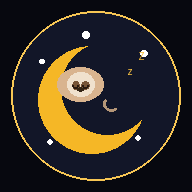
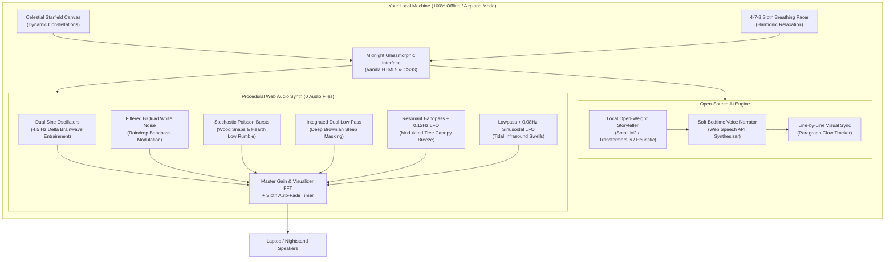

# SnoozeScape 🦥
### *100% Offline Ambient Bedtime AI & Procedural Soundscape Companion*

> *Drift into deep, restorative sleep with mathematical soundscapes and private local AI bedtime tales.*

<p align="center">
  
</p>

<p align="center">
  <a href="https://snoozescape.onrender.com" target="_blank">
    
  </a>
  <a href="https://render.com/deploy?repo=https://github.com/sachinn-alt/snoozescape">
    
  </a>
  <a href="LICENSE">
    
  </a>
  <a href="CONTRIBUTING.md">
    
  </a>
</p>

<p align="center">
  👉 <strong><a href="https://snoozescape.onrender.com">Try the Live Web App on Render: https://snoozescape.onrender.com</a></strong> 👈<br>
  <em>(100% Client-Side • Runs seamlessly in any modern browser on Desktop, Tablet, and Mobile)</em>
</p>

---

## 🌟 What is SnoozeScape?

Sloths have sleep figured out: they move at 0.15 mph, conserve their energy, and never stress over unread notifications. **SnoozeScape** is an open-source, privacy-first sleep companion built to channel that exact philosophy.

When you climb into bed, the last thing you want is a screen blasting blue light, an app demanding account login, or cloud APIs draining your battery while tracking your intimate evening habits.

With SnoozeScape:
1. Put your laptop, phone, or tablet on your nightstand.
2. Turn on **Airplane Mode** (no Wi-Fi needed).
3. Click **"Instant Sloth Mode"** (or do literally nothing else).

SnoozeScape generates an original, calming bedtime story using local open-weight AI, reads it aloud with a soothing whisper-paced narrator, and synthesizes a multi-layered procedural soundscape (rain, fireplace, ocean swell, canopy wind, brown noise, and 4.5Hz binaural delta sleep waves) **directly in your browser with pure mathematics**. As you drift off, the auto-fade timer gently quiets the audio and dims your screen to pitch black.

---

## ✨ Rich Interactive Experiences

- 🧠 **Sleep Neuro-Lab & Mind Release Sanctuary:**
  - **Binaural Brainwave Tuning Station:** Fine-tune target brainwave frequencies in real time across **Deep Delta (2.5 Hz)**, **Theta REM (5.5 Hz)**, **Schumann Resonance (7.83 Hz)**, and **Twilight Alpha (10.0 Hz)** with harmonic carrier frequency selection (196 Hz G3, 432 Hz Verdi, 528 Hz Solfeggio).
  - **Dissolve Worries to Stardust:** Type any lingering daily anxieties and tap "Dissolve to Stardust" to watch thoughts disintegrate into glowing particles drifting into the night sky, accompanied by a resonant 432 Hz Tibetan bronze singing bowl and soothing bedtime affirmations.
  - **Circadian 90-Minute REM Cycle Guide:** Real-time sleep cycle math calculating optimal wake times based on natural REM rhythm (90 min cycles + 14 min sleep latency) so you wake up refreshed and free of sleep inertia.
- 🌌 **Interactive Celestial Sky Canvas:** Ambient drifting and softly pulsing starfield with real-time stardust particle physics.
- 🫧 **Interactive Breathing Pacer:** Choose between **4-7-8 Deep Sleep**, **4-4-4 Box Breathing**, or **4-6 Ocean Flow** with optional harmonic acoustic cues and tap-to-sync feedback.
- 📊 **Multi-Mode Live Audio Visualizer:** Cycle in real-time between **Spectrum Equalizer Bars**, **Fluid Sine Oscilloscope Wave**, and **Concentric Nebula Pulse Rings**.
- 🎛️ **Procedural Mixer with "Randomize Mix 🎲":** Blend your 6 ambient generators or let the engine roll a balanced, calming mix with animated slider transitions.
- 🔔 **Tibetan Singing Bowl (432 Hz):** Synthesized physical acoustics using harmonic sine wave decay to center the mind before sleep.
- 📖 **Interactive Bedtime Tale Companion:** Click any paragraph to read aloud from that exact line with golden glowing tracking, generate randomized dream inspiration, and toggle candlelight eye-comfort reading mode.
- 🌿 **Bedtime Health & Mental Wellness Sanctuary (Interactive):**
  - **Evening Nervous System Down-Shift (Interactive Somatic Checklist):** 4 actionable micro-steps (jaw/shoulder de-armoring, guided 3x physiological sigh with interactive live timer, screen sunset & bedroom cooling, good-enough permission slip) with live sleep-readiness percentage tracker (`0% -> 100% Primed for Sleep`), particle stardust bursts upon completion, and local storage state persistence.
  - **Cognitive Shuffle Mind Calmer (Dr. Luc Beaudoin):** Clinically proven cognitive science technique that disrupts bedtime anxiety loops by cycling through randomized, peaceful sensory concepts every 3.5 seconds to trigger natural hypnagogic sleep onset.
  - **Actionable Bedtime Wellness Prescriptions:** Categorized evidence-based step-by-step guidance across *Racing Mind*, *Body Tension*, *Melatonin Biology*, and *Self-Compassion*, with direct one-tap action triggers (`Dissolve Worries`, `Start Guided 4-7-8 Breathing`, `Ring 432Hz Bowl`, `Toggle Candlelight Mode`, `Start 30-Min Sleep Fade`).
- 💎 **Iconly Pro Vector Icon System:** Integrated official free vector iconography from [Iconly Pro](https://web.iconly.pro/?is_free=1) across the header, soundscape controls, ambient generators, breathing pacer, and floating action dock for a cohesive, ultra-refined UI.


---

## 🏗️ System Architecture



---

## 🦥 Effortless Sleep Automation

| Effort Spent by You | What SnoozeScape Does Automatically |
| :--- | :--- |
| **1 Single Click** on "Instant Sloth Mode" | Starts soundscape, sets 30-min fade timer, generates a fresh bedtime story, and starts slow narration. |
| **0 Seconds Writing Prompts** | Choose from curated themes (*Sloth Sanctuary*, *Midnight Highland Train*, *Starlit Library*, *Pine Hearth*) or tap generate. |
| **0 App Logins or Signups** | No passwords, no accounts, no credit cards, no verification emails. |
| **0 Battery-Wasting Streaming** | All 6 soundscapes are synthesized mathematically in real time—zero megabytes of audio streamed over Wi-Fi. |
| **0 Waking Up to Loud Noise** | In the final minutes of your sleep timer, the master audio gently tapers to zero decibels and the screen dims to black. |

---

## 🛡️ Why Open Innovation Matters

Closed-source AI products (commercial meditation apps, proprietary LLM APIs, and cloud text-to-speech services) suffer from four fundamental flaws when used in the bedroom:

1. **Intimate Privacy Violations:** Sleep schedules, bedtime conversations, emotional states, and meditation logs are prime targets for user profiling and advertising data brokers. SnoozeScape sends **0 network requests**; everything stays strictly in local browser memory.
2. **The "Airplane Mode" Paradox:** Cloud AI requires a 24/7 active internet connection on your bedside table—emitting radio frequencies and risking midnight notification chimes. Open-source local AI works in a remote cabin, during a power outage, or with your laptop in full Airplane Mode.
3. **Zero Token Fees & Subscription Traps:** Closed voice APIs charge per character, causing apps to slap users with monthly subscriptions or cut off audio mid-meditation when quota limits are hit. Open-weight models are free forever.
4. **Customizable & Transparent:** Want to modify the binaural frequency from 4.5Hz to 7.83Hz (Schumann resonance)? Want to customize the story tropes or train a custom Sloth persona? With open source, you own the code and the model pipeline.

---

## 🎵 Dual-Engine Soundscape Architecture: Math Synth & Studio CC0 Recordings

SnoozeScape features a **hybrid dual-engine audio architecture** offering seamless switching between pure mathematical real-time synthesis and organic CC0 acoustic field recordings:

### Mode 1: Pure Math Synth (0 MB Downloads)
All 6 sleep layers synthesized mathematically in real time via the browser's native **Web Audio API**:
- **Binaural Delta Beats:** Dual stereo-panned sine wave oscillators (Left: 196.0 Hz, Right: 200.5 Hz) generating a 4.5 Hz frequency differential to trigger deep restorative slow-wave sleep.
- **Nocturnal Rain:** Dual-filtered noise generator (Highpass at 280Hz, Lowpass at 1200Hz) simulating steady rain falling onto tropical canopy foliage.
- **Cozy Fireplace:** Low-frequency 140Hz rumble coupled with stochastic bandpass Poisson impulses (2400Hz, Q=4.0) to emulate snapping embers.
- **Deep Brown Noise:** Cascading 12dB/octave lowpass-filtered Brownian noise providing acoustic masking against sudden ambient room noises.
- **Canopy Wind:** Resonant bandpass filter modulated by a 0.12Hz sinusoidal LFO, producing gentle forest wind gusts.
- **Ocean Swell:** 0.08Hz infrasonic LFO modulating gain and frequency, mimicking the natural 12-second rhythm of breaking ocean tides.

### Mode 2: Studio CC0 Field Recordings (100% Copyright-Free & Offline)
High-fidelity, loopable acoustic recordings dedicated to the **Public Domain (CC0 / Open Source)**. Pre-cached by the Service Worker for complete offline playback without streaming or data usage:
- **Nocturnal Rain (`rain.mp3`):** High-fidelity microphone capture of gentle nocturnal precipitation.
- **Campfire Hearth (`fire.mp3`):** Real wood embers crackling in an open brick hearth.
- **Forest Wind (`wind.mp3`):** Gentle wind whistling through mountain pine canopy.
- **Pacific Ocean (`ocean.mp3`):** Natural rhythmic coastal swells and breaking shore waves.
- **Deep Brown Noise (`brown.mp3`):** Authentic analog Brownian noise sleep masking.
- **Nocturnal Crickets (`night.mp3`):** Peaceful midnight meadow insects and evening breeze.
- **432Hz Tibetan Singing Bowl (`tibetan-bowl.mp3`):** Acoustic bronze singing bowl strike with natural physical overtones.
*(See [AUDIO_LICENSES.md](assets/audio/AUDIO_LICENSES.md) for full provenance and license details).*

---

## 🚀 Getting Started Locally

### Quick Start (No Install Required)
Simply open `index.html` in any modern web browser (Chrome, Edge, Firefox, Brave, Safari):
```bash
# Clone the repository
git clone https://github.com/sachinn-alt/snoozescape.git
cd snoozescape

# Open directly in browser
# On Windows:
start index.html
# On macOS:
open index.html
# On Linux:
xdg-open index.html
```

### Local Dev Server
```bash
npx serve -l 3000 .
# Open http://localhost:3000
```

## 📱 Offline PWA & Mobile-Ready

SnoozeScape is a full-featured **Progressive Web App (PWA)**:
- **100% Offline Service Worker (`sw.js`):** Pre-caches the entire application bundle (styles, logic, mathematical audio synthesizer, AI engine, and vector icons). Runs in full Airplane Mode with zero network connectivity.
- **Installable on iOS & Android:** Add directly to your smartphone home screen with standalone display, custom splash screen (`#07080f`), and sleep shortcuts.
- **Mobile Floating Action Dock:** Inspired by Skiper UI, featuring thumb-friendly controls for instant sleep mode, soundscape toggles, 4-7-8 breathing meditation, and bedtime tales.
- **Aceternity UI Design System:** Dynamic dot-matrix grid with radial moonlight masks, ceiling lamp ambient glow, spotlight cursor tracking, and continuous border-beam physics.

---

---

## ☁️ Live Demo & 1-Click Deploy on Render

### 🌐 Live Production URL
Experience SnoozeScape instantly in your browser:
**[https://snoozescape.onrender.com](https://snoozescape.onrender.com)**

### Deploy Your Own Copy in 60 Seconds
This project includes a ready-to-use [`render.yaml`](render.yaml) Blueprint for instant 1-click deployment on [Render](https://render.com):

[](https://render.com/deploy?repo=https://github.com/sachinn-alt/snoozescape)

1. Click the **Deploy to Render** button above (or connect your GitHub repository in the Render dashboard).
2. Render automatically detects `render.yaml` and deploys SnoozeScape as an ultra-fast static web app worldwide with free automated SSL and global CDN edge caching!

---

## 🤝 How to Contribute

We love contributions! Whether you're fixing a typo, designing a new soundscape generator, expanding wellness rituals, or translating stories, your help makes healthy bedtime rest accessible to everyone.

### 🌟 Why Contributing is Easy
- **Zero Heavy Toolchains:** Built with pure vanilla HTML5, CSS3, and modern JavaScript (ES Modules). No Node.js build steps, no Webpack/Vite bundlers, and no giant `node_modules` folder to download!
- **100% Offline Development:** You can build, debug, and test features completely offline in Airplane Mode.

### ⚡ Quick 3-Step Setup
```bash
# 1. Clone your fork
git clone https://github.com/<your-username>/snoozescape.git
cd snoozescape

# 2. Run locally (choose whichever you prefer):
# Instant: Double-click index.html
# Or run with Python:
python -m http.server 3000
# Or run with Node:
npx serve -l 3000 .

# 3. Open in your browser:
# http://localhost:3000
```

### 🗺️ Project Architecture at a Glance
| File | Role & Technology |
| :--- | :--- |
| [`index.html`](index.html) | Semantic UI markup, Bento grid sections, accessible SVG icon sprite |
| [`styles.css`](styles.css) | Aceternity-inspired midnight glassmorphism, responsive dock, animations |
| [`app.js`](app.js) | App orchestrator, canvas starfield particles, UI event binding |
| [`audio-engine.js`](audio-engine.js) | Pure Web Audio API procedural synthesizers + CC0 public domain audio players |
| [`ai-engine.js`](ai-engine.js) | 100% local client-side bedtime storytelling heuristics & Transformers.js |
| [`sw.js`](sw.js) | Offline Service Worker with Cache-First + Stale-While-Revalidate caching |
| [`render.yaml`](render.yaml) | Infrastructure-as-code Blueprint for automated 1-click Render deployment |

### 💡 Great Areas to Contribute
- 🌿 **Health & Mental Wellness Sanctuary:** Add new bedtime somatic rituals, reflection check-ins, or new concepts to the **Cognitive Shuffle** engine (`app.js`).
- 🎵 **Procedural Audio Synthesis:** Create new mathematical Web Audio sound layers (e.g., gentle mountain brook, summer night crickets, cat purring) in `audio-engine.js`.
- 📖 **Bedtime Story Themes:** Write calming new story prompts and dream tropes in `ai-engine.js`.
- 🎨 **Aesthetic Themes:** Add new calming color palettes (e.g., *Aurora Borealis*, *Warm Amber Dusk*) in `styles.css`.
- 🌐 **Translations (i18n):** Help translate UI labels, bedtime tales, and wellness guidance into other languages.
- ♿ **Accessibility & Performance:** Enhance keyboard navigation, ARIA announcements, and canvas battery efficiency.

### 📜 Contribution Process
1. Create a feature branch: `git checkout -b feat/your-feature-name`
2. Test your changes and ensure zero syntax errors: `node --check app.js`
3. Commit with clear messages: `git commit -m "feat(audio): add mountain brook procedural stream"`
4. Push to your fork and submit a Pull Request!

👉 For full details, coding standards, and community guidelines, check out our **[CONTRIBUTING.md](CONTRIBUTING.md)**.

---

## 📜 License

Distributed under the **MIT License**. See [LICENSE](LICENSE) for details.
