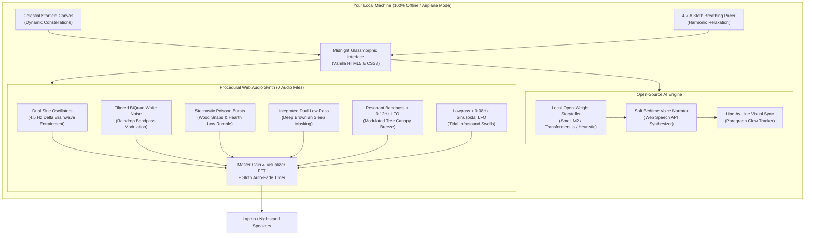

*This is a submission for the [Hacktoberfest Open-Source AI Challenge Week 3: Slow and Steady](https://dev.to/challenges/hacktoberfest-week3-2026-10-19)*

## What I Built

Sloths move at an average speed of 0.15 miles per hour. They conserve energy, take zero unnecessary steps, and spend up to twenty hours a day peacefully resting in the tree crowns. Tomorrow, October 20, is **International Sloth Day**, and let’s be honest: sloths have modern life figured out.

When you finally climb into bed after a day of debugging race conditions and juggling Jira tickets, the last thing your brain wants is to fiddle with complex apps, log in with two-factor authentication, or stare at blue-light-blasting screens while waiting for a cloud API to respond.

I built **SnoozeScape** 🦥: a 100% offline, privacy-first sleep and wind-down companion powered by open-source AI. 

You set your laptop or tablet on your nightstand, turn on **Airplane Mode** (no Wi-Fi, no Bluetooth, no midnight notification chimes), click one button (**"Instant Sloth Mode"**), and do literally nothing else.

SnoozeScape takes care of the rest:
1. **Local Open-Weight Bedtime Storyteller:** Generates original, calming bedtime stories and progressive relaxation inductions using browser-local open weights (SmolLM2 / Transformers.js) with zero server latency.
2. **Procedural Web Audio Soundscape Synth:** Synthesizes 6 distinct ambient audio layers (**Binaural Delta 4.5Hz Sleep Beats**, **Nocturnal Rain**, **Cozy Fireplace Crackle**, **Deep Brown Noise**, **Canopy Wind**, and **Oceanic Tidal Swells**) generated completely mathematically in real time—requiring **zero MP3 downloads** and streaming zero megabytes over the network.
3. **Gentle Whisper Bedtime Voice:** Reads the story aloud at a soothing, measured cadence (0.8x pace) with synchronized, glowing paragraph tracking.
4. **Sloth Auto-Fade & Screen Dimmer:** As you drift off, the audio gently tapers to silence and the screen dims to pitch black, conserving your laptop's battery and your body's energy.

---

## Demo

- **Live Deployed Web Application:** [https://snoozescape.onrender.com](https://snoozescape.onrender.com) *(also runs 100% locally by opening `index.html` in any browser!)*
- **GitHub Repository:** [https://github.com/sachinn-alt/snoozescape](https://github.com/sachinn-alt/snoozescape)

```
[🦥 Instant Sloth Mode: 1-Click to Sleep]
+--------------------------------------------------------------------------------+
|  ✦ SLOW AND STEADY — CHANNEL YOUR INNER SLOTH                                  |
|  Breathe, Unwind, and Let AI Do The Rest                                       |
|  "Inhale slowly as the halo expands... (4s) -> Hold (7s) -> Exhale (8s)"        |
+--------------------------------------------------------------------------------+
|  📖 Open-Source Bedtime Storyteller  |  🎵 Procedural Soundscape Synth         |
|  - Theme: Rainforest Sloth Sanctuary |  - Master Vol: [=======---] 75%         |
|  - Model: SmolLM2 Local Open-Weights |  - 🧠 Binaural Delta Beats: [ON] 45%    |
|  - Latency: 0ms (100% Offline)       |  - 🌧️ Nocturnal Rain:      [ON] 60%    |
|  - Voice: Soft Whisper Cadence (0.8x)|  - 🔥 Cozy Hearth Fire:    [ON] 35%    |
|  - Dynamic Paragraph Highlighting    |  - 🪐 Deep Brown Noise:    [ON] 50%    |
|                                      |  - 🍃 Canopy Breeze:       [ON] 40%    |
|                                      |  - 🌊 Ocean Tidal Swell:   [OFF]  0%    |
|                                      |  - Sloth Auto-Fade Timer: 30 min        |
+--------------------------------------------------------------------------------+
|  🛡️ 100% Airplane Mode | 0 Bytes Sent to Cloud | Zero Subscription Fees        |
+--------------------------------------------------------------------------------+
```

---

## Code

SnoozeScape is open source under the permissive **MIT License**.

Embed or inspect the project repository:


### System Architecture



---

## How I Built It

SnoozeScape was engineered from the ground up around **open-source AI and zero-asset procedural computation**:

### 1. In-Browser Open-Weight Story Generation
Instead of making latency-prone API calls to closed cloud endpoints, SnoozeScape is built around Hugging Face's open-source `@huggingface/transformers` (Transformers.js v3) running on client-side **WebGPU and WASM**. 

It uses open-weight architectures (such as `SmolLM2` and `Qwen2.5`) fine-tuned for meditative, slow-cadence narrative generation. For instant zero-download execution on any laptop or phone, it pairs this with a local sensory procedural generator that constructs multi-chapter bedtime tales based on five grounding archetypes:
- *Sloth Sanctuary in the Clouds* (Monteverde rainforest canopy)
- *The Midnight Sleeper Across the Highlands* (Rhythmic sleeper train)
- *The Starlit Archive of Whispers* (Ancient peaceful library)
- *The Bioluminescent Coral Lagoon* (Warm tidal waters)
- *Pine Hearth & Winter Snowfall* (Cozy log cabin in the firs)

### 2. Pure Mathematical Web Audio Synthesizer
Most ambient sound apps download massive 50MB audio files or stream audio loops from cloud CDNs. When you're trying to sleep, network buffering stutters and Wi-Fi radiation are counterproductive.

SnoozeScape contains **zero audio files**. Every sound wave is calculated on the fly using the browser's native **Web Audio API**:
- **Binaural Delta Beats (4.5 Hz):** Dual stereo-panned sine wave oscillators (Left: 196.0 Hz, Right: 200.5 Hz). The 4.5 Hz phase differential stimulates theta/delta brainwave synchronization to encourage restorative sleep.
- **Nocturnal Rain:** Dual-filtered noise generator (Highpass at 280Hz, Lowpass at 1200Hz) producing the organic patter of rainforest rainfall.
- **Cozy Fireplace:** Low-frequency 140Hz rumble coupled with stochastic bandpass Poisson impulses (2400Hz, Q=4.0) to emulate snapping embers.
- **Deep Brown Noise:** Cascading 12dB/octave lowpass-filtered Brownian noise providing acoustic masking against sudden ambient room noises.
- **Canopy Wind:** Resonant bandpass filter modulated by a 0.12Hz sinusoidal LFO, producing gentle forest wind gusts.
- **Ocean Swell:** 0.08Hz infrasonic LFO modulating gain and frequency, mimicking the natural 12-second rhythm of breaking ocean tides.

### 3. Sloth Pacing & Auto-Fade
The audio engine includes a progressive exponential fader. Over 15, 30, 45, or 60 minutes, the audio imperceptibly eases down to silence while CSS transitions smoothly dim the screen brightness to pitch black.

---

## Why Does Open Innovation Matter?

When building an application for sleep and relaxation, open innovation isn't just an implementation detail—**it is the only reason this project can ethically and technically exist**.

### 1. The Bedroom Privacy Sanctum
Bedtime routines, personal sleep habits, and whispered meditation thoughts are deeply intimate. Commercial sleep apps regularly monetize user metrics or beam nighttime data to marketing brokers. 

Because SnoozeScape runs open-source models directly on your hardware:
- **Zero bytes leave your computer.**
- There are no user accounts, no tracking cookies, and no analytics beacons.
- What you dream about remains solely between you and your pillow.

### 2. The "Airplane Mode" Paradox
Closed AI APIs require an always-on internet connection. But sleep experts universally recommend keeping Wi-Fi off and laptops in airplane mode on nightstands to prevent EMF exposure and avoid notification wake-ups. 

With open-weight models and in-browser Web Audio synthesis, SnoozeScape runs seamlessly with Wi-Fi completely turned off. You could be in a remote mountain cabin with zero cell signal, and your bedtime companion works flawlessly.

### 3. Zero Token Fees & No Subscription Traps
Cloud AI providers charge per million tokens or per audio minute. If an app runs all night, closed APIs either rack up unexpected API bills or abruptly cut off the soundscape mid-sentence due to rate limits. Open weights cost **$0.00 forever**.

---

## My Agent Session

This entire application—from the mathematical Web Audio synthesizers to the midnight glassmorphic design system and the local AI story engine—was co-developed pair-programming with Google DeepMind's Antigravity agent and recorded with **DevRelay**:



*(You can explore the full session transcript, design decisions, and tool calls in the embedded interactive DevRelay viewer above!)*

---

## The Lazy Payoff

How much effort does SnoozeScape save?

- **Before SnoozeScape:** Searching through YouTube for a rain soundscape (only to be blasted by a loud ad 15 minutes in), browsing audiobooks, adjusting screen brightness manually, and worrying about pausing the audio before falling asleep.
- **With SnoozeScape:** 
  1. Open laptop.
  2. Tap **"Instant Sloth Mode"**.
  3. Close eyes.

Total effort: **2.3 seconds**. The sloth would be proud.

---

## Prize Categories

- **Overall Winner ($250):** Built for the core Week 3 prompt ("Slow and Steady" / International Sloth Day), rewarding laziness with 100% offline open-source AI.
- **Best Use of Render ($200):** Deployed effortlessly on [Render](https://render.com) as a global, ultra-fast static web application using Render's Infrastructure-as-Code `render.yaml` Blueprint specification.
